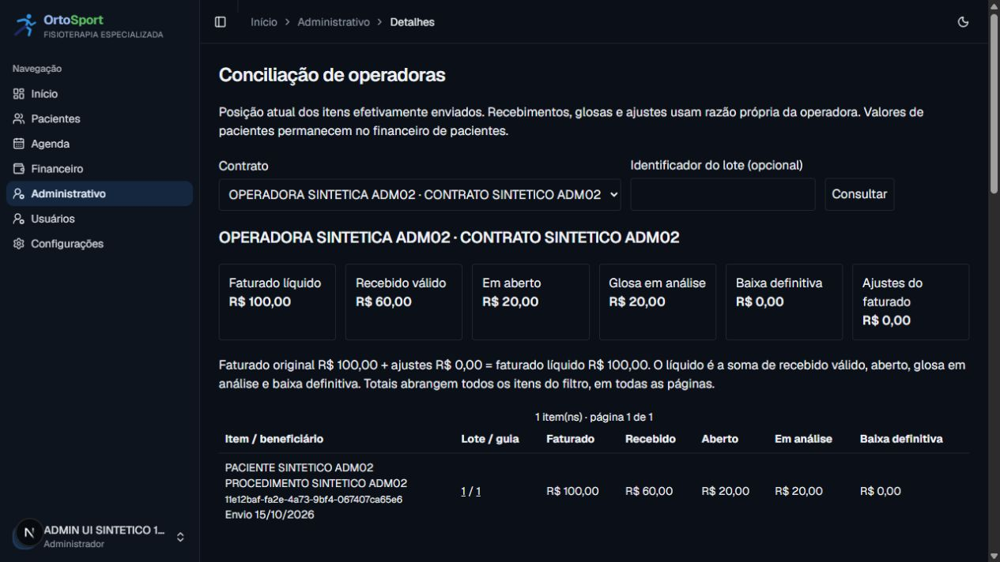

# ADM-08 (#104) — conciliação de operadoras

Implementação local em 15/10/2026, na branch `codex/issue-104-conciliacao`, sobre as
entregas integradas #99–#103. Contratos ratificados da #96, especialmente D-08/D-09/D-14.
PR, merge e publicação da #104 são etapas separadas; nenhuma migração remota foi executada.

## Resultado

- Obrigação própria por item congelado do primeiro envio. `OperatorReceivable` guarda
  contrato, lote, guia, produção, envio original, centavos e data civil de faturamento.
  Correções/reenvios do lote não geram outra obrigação. Fechamento/XML não geram recebível.
- `OperatorSettlement`/`OperatorSettlementLine` preservam demonstrativo, motivo, autor,
  data efetiva, instante técnico, fingerprint e todos os movimentos, sem AuditLog como razão.
- Recebimento exige 100% de alocação explícita no mesmo contrato, inclusive vários lotes.
  Excedente e saldo não alocado são recusados. Limite: maxItems do contrato ou 1.000 linhas
  novas, o que for menor, sem truncamento.
- Glosa por item e origem: análise, baixa justificada, reabertura e liberação manual.
  Pagamento de glosa libera só sua parcela e aloca o recebido na mesma transação.
- Estorno recompõe as classificações originais. Substituição grava inversão e novas
  alocações atomicamente. Estornar um substituto não reativa o recebimento anterior.
- Ajustes explícitos alteram faturado líquido; não modificam lote, XML nem Charge/Payment.
  Recebido, aberto, análise e baixa são classes exclusivas, sem dupla contagem.
- Tela de conciliação, histórico e detalhes com paginação própria, totais integrais e
  navegação a partir do Administrativo, Financeiro e lote enviado. Leituras sob
  administrativo:ler; escrita somente ADMIN sob administrativo:conciliar. Projeção
  operacional não transfere indicação clínica nem prontuário.

## Validação

- Suíte unitária completa: **118 suítes / 1.325 testes aprovados**, incluindo validação
  exata de valores, permissões antes do banco, autoria da sessão, campos forjados e
  formulários com requestId estável e erro acessível.
- Regressão PostgreSQL completa: **42 suítes / 275 testes aprovados**, incluindo os
  **20 cenários da #104**, financeiro #86–#88, manutenção e exclusão de usuários.
- R$100 = R$60 recebidos + R$20 em análise + R$20 abertos. Estornar os R$60 leva
  recebido a zero e aberto a R$80, preservando os R$20 em análise e o demonstrativo.
- Glosa R$52,37 com pagamento de R$40 deixa R$12,37 em análise; estorno restaura
  a origem. Baixa/reabertura/liberação mantêm original, código e revisão vinculada.
- Concorrência: alocação contra alocação, pagamento contra baixa da mesma glosa,
  reenvio idêntico, estornos simultâneos e SQL direto. Um saldo nunca é consumido duas vezes.
- Falha no substituto reverte toda a transação. Banco recusa inversão incompleta,
  evento sem alocações, append posterior, alteração/exclusão e pagamento de baixa definitiva.
- Valor `9007199254740993` centavos persistido e consultado exatamente, sem `number`.
  Paginação de 25 itens/21 glosas/42 eventos preserva totais de todas as páginas.
- Dez testes do pipeline aprovados; migração aceita pelo gate aditivo. TypeScript e
  ESLint aprovados. Build e runtime XML rastreado conferidos na conclusão da entrega.

Houve uma falha inicial na fixture de manutenção, ajustada para semear as novas tabelas,
e um timeout local na suíte clínica durante compilação de desenvolvimento concorrente.
A suíte clínica passou isoladamente e toda a regressão passou novamente com o servidor
de desenvolvimento desligado, sem ampliar timeouts nem alterar regras clínicas.

## Migração e recuperação

`20261015190000_administrativo_conciliacao` é aditiva e transacional. Inclui backfill
somente de primeiros envios e triggers de obrigação, formas, datas, origem, integralidade,
inversões exatas, saldo e imutabilidade. Operações serializam por contrato; linhas só
entram na transação que criou o cabeçalho, e o saldo é conferido no commit.

Aplicação em PostgreSQL 18 local novo aprovada. Uma cópia sintética do banco da #103
foi migrada: **7 obrigações / 73.318 centavos**, iguais aos 7 primeiros envios originais.
Sem migração de Charge/Payment e sem criar recebimentos durante o backfill.

Ensaio local `pg_dump -Fc`/`pg_restore` para outro banco descartável: **144 obrigações,
232 eventos e 238 linhas**. Contagens e hashes de todas as colunas/linhas das três tabelas
iguais antes/depois; referências restauradas com o restante do banco. Não é ensaio de
PITR remoto. Inventário de recuperação, reset e FKs de autoria atualizados.

## Navegador → ação → banco → tela

ADMIN sintético registrou R$60 e glosa de R$20 pela interface. Ambas as ações retornaram
histórico com autor, protocolo e datas. A tela mostrou R$100/R$60/R$20/R$20 e o SQL direto
confirmou `10000 | 6000 | 2000 | 2000` centavos. Captura somente com dados fictícios:

## Limites

A consulta representa posição atual, não corte histórico por data. Data efetiva não
pode anteceder o envio/origem; estorno/substituição não antecede o recebimento original.
Se uma revisão posterior consumir a classificação que seria restaurada, revisar os atos
dependentes antes de estornar. Saldo não alocado, crédito excedente, importação de
demonstrativos, devolução bancária, conciliação bancária, repasse e recurso eletrônico
permanecem fora desta entrega. Nenhum dado do anexo real foi usado.
