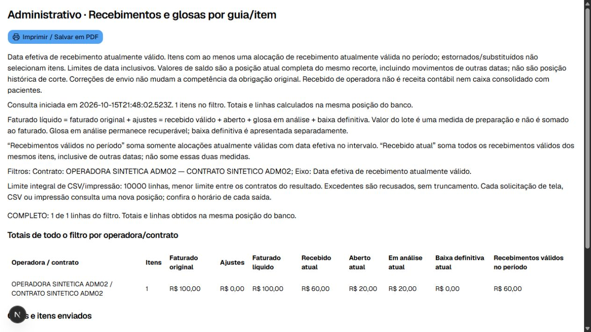

# ADM-09 (#105) — relatórios financeiros por operadora

Implementação local em 15/10/2026 na branch `codex/issue-105-relatorios`, sobre
`17effb2` (#104). Segue os contratos da #96 e reutiliza produção, filtros/CSV/impressão,
guias, lotes, envio TISS e razão de conciliação das #99–#104.
PR, merge e publicação em Preview permanecem pendentes. Não há alteração de schema
nem migração nova nesta issue. Nenhuma migração remota foi executada.

## Resultado e critérios

- Faturamento: uma linha por lote inteiro fechado/enviado, por fechamento ou primeiro
  envio. Lote apenas fechado apresenta valor preparado, com faturado/recebido/saldos
  financeiros zerados. Correção de envio não muda a competência original.
- Recebimentos/glosas: uma linha por obrigação de item enviado, com navegação a lote,
  guia, produção e conciliação. Filtros por operadora, contrato, lote, guia, paciente,
  procedimento, profissional, posição atual e período inclusivo.
- Eixos distintos: execução, fechamento civil em São Paulo, envio original, recebimento
  válido e registro original de glosa. Os últimos dois selecionam itens por movimentos
  no período; os saldos continuam sendo a posição atual completa desses mesmos itens.
  Medidas específicas do período aparecem separadas e não devem ser somadas aos saldos.
- Razão agregada por obrigação antes dos demais relacionamentos, evitando multiplicar
  pagamentos/glosas. Centavos são `numeric` no SQL e `bigint` na aplicação/CSV.
  Contagem, totais integrais, linhas e rótulos usam a mesma transação Repeatable Read.
- Tela paginada em 20 linhas; CSV/impressão integrais recusam excedentes sem truncamento,
  usando o menor `maxExportRows` dos contratos do resultado. Filtros e critério acompanham
  cada saída; cada solicitação consulta uma nova posição, identificada pelo horário.
- Autorização própria em leitura, exportação, impressão e busca de opções. CSV privado,
  sem cache, com BOM UTF-8, separador ponto e vírgula, proteção contra fórmulas e centavos
  exatos. Projeções não incluem indicação clínica, prontuário, senha ou carteirinha.
- Não representa receita contábil, DRE, caixa consolidado nem posição histórica de corte.

## Verificação

- Jest completo: **121 suítes / 1.350 testes aprovados**. Após separar as constantes
  compartilhadas do módulo SQL, os 25 testes específicos foram repetidos.
- PostgreSQL completo: **43 suítes / 288 testes aprovados**, incluindo 13 cenários
  desta issue e regressões das entregas anteriores. Banco local exclusivamente sintético.
- Pipeline: **10 testes aprovados**. TypeScript e ESLint sem erros.
- Build de produção Next.js 16.3.5 com Webpack aprovado no Windows. Verificação do
  pacote físico TISS, schemas e validação isolada também aprovada após o build.
- Casos novos: vários períodos/operadoras, alocação de um pagamento entre lotes,
  múltiplos recebimentos/glosas sem duplicação, ajustes, estorno/substituição, fechamento
  sem envio, correção de envio, datas inclusivas e fuso, contratos/pacientes inativos,
  duas páginas com totais integrais, limites de exportação, resultado vazio e centavos
  acima de `Number.MAX_SAFE_INTEGER`.
- Concorrência: inserção de recebimento entre contagem e linhas não mistura posições,
  tanto no relatório por lote como no relatório por item. Consulta seguinte vê o movimento.
- Navegador local: filtro por contrato, troca do eixo para recebimento e impressão
  integral com filtros preservados. Exemplo independente da tela: 10.000 centavos
  faturados − 6.000 recebidos − 2.000 em análise = 2.000 abertos; baixa zero.
  A captura abaixo usa apenas nomes e operações sintéticos da fixture local da #104.
- Os testes de relatório usam artefato sintético pelo porto interno de envio; não
  constituem homologação TISS com operadora. A validação real de XML permanece na #103.

Logs locais de execução ficam em `release/105-*.log` (ignorados pelo Git).
