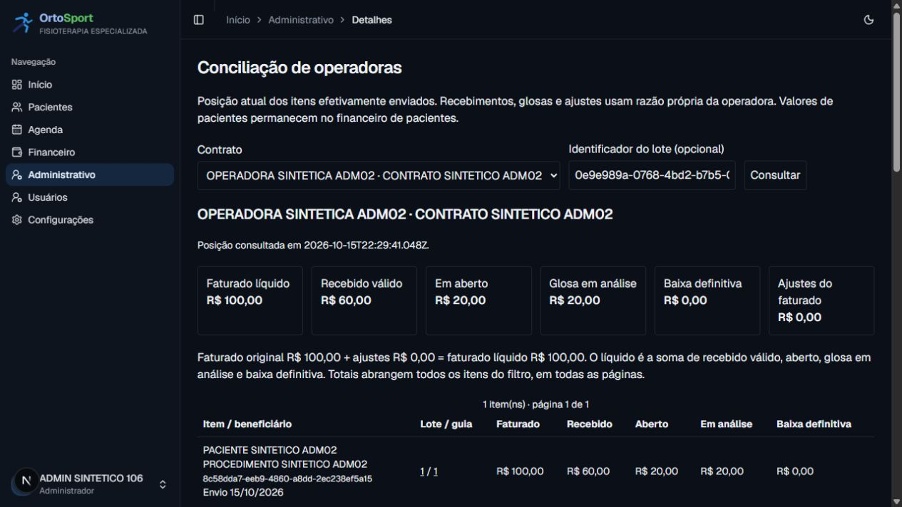

# ADM-10 (#106) — validação integrada do ciclo

Validação local em 15/10/2026, baseada em `a34034d` (main com #105), executável
consolidado em `19b48e888c2d16de9f3408b32c8ca2e6e6c48530`. Ambiente: Windows,
Node 24.20.0, pnpm 11.25.0, PostgreSQL 18 no container local de testes.
Massa exclusivamente fictícia; nenhum dado do anexo real utilizado.

## Estados e aceite

| Critério | Evidência / estado |
|---|---|
| Ciclo concilia autorização e dinheiro | Teste integrado e executor reproduzível: 10 autorizados, 2 usados, 8 disponíveis; R$100 = R$60 recebidos + R$20 abertos + R$20 análise |
| XML aceito no perfil piloto | **PENDENTE EXTERNO**: sem operadora/manual/canal/protocolo real. Usuário determinou manter a pendência e validar localmente |
| Recuperação mantém arquivos e vínculos | pg_dump/pg_restore em banco novo; 51 tabelas com os mesmos dados, XML byte a byte, SHA-256, relações e autoria preservados |
| Checks e ambiente identificados | Resultados abaixo e manifesto `106-volume.json`, com SHA e árvore limpa no início do ensaio |
| Production depende de liberação manual | Política/pipeline preservadas; nenhum deploy ou envio externo realizado na #106 |

Código e validação local não encerram o aceite externo da #106 nem o épico #95.
#97–#105 estão integradas; #105 foi publicada em Preview no SHA `17f9c47`,
workflow `38814245719`. A #106 permanece local, sem PR/merge/publicação nesta etapa.
Não há nova migração; os bancos de ensaio aplicam o histórico completo até
`20261015190000_administrativo_conciliacao`.

## Rastreabilidade do ensaio

`scripts/administrativo/validate-local.mjs` cria dois bancos novos, sem sobrescrever,
sem DROP e sem ler .env/aceitar conexão remota. Reutiliza a fixture XML da #103 e
os serviços reais de #97–#105. A massa percorre cobertura/autorização, sessão,
produção conferida, guia apta, fechamento, geração/validação XSD real, envio manual
**apenas simulado no banco local**, recebimento parcial, glosa e os dois relatórios.

O perfil técnico PRODUCAO da fixture serve somente para exercitar o gate de envio e
a obrigação em banco descartável. A confirmação é fictícia, não um aceite de versão
pela operadora. O arquivo não foi transmitido. A simulação cria zero Charge/Payment
de paciente; fechamento/XML não criam recebível; primeiro envio cria exatamente um
por item. Replays de fechamento, XML, envio e recebimento não duplicam fatos.

O restore usa `--exit-on-error --single-transaction`. Compara hashes de todas as linhas
de todas as tabelas, bytes/digest/metadata do XML, FKs/constraints, triggers, funções e
sequências. CHECKs têm identidade/tipo/colunas/validação comparados; não se exige texto
idêntico de casts que PostgreSQL reescreve de forma equivalente no restore. As demais
constraints mantêm definição exata. O guard restaurado recusa UPDATE dos bytes e os
totais restaurados são conferidos novamente. Não regeneramos arquivo para compará-lo.

Logs e manifestos completos ficam em `release/106-*` (ignorados pelo Git), incluindo
nomes dos bancos novos preservados para inspeção e arquivo pg_dump no container.
O manifesto resumido versionado contém apenas dados sintéticos e hashes.

## Testes e limites

- Jest: **122 suítes / 1.355 testes aprovados**. Nova matriz negativa chama diretamente
  16 actions administrativas, leitores, CSV de produção/faturamento/conciliação,
  impressão e download XML, com anônimo, papel desconhecido e ADMIN/Recepção/Fisio
  inativos. As suítes existentes exercitam os três perfis ativos, permissões de escrita,
  campos forjados, autoria da sessão e projeções administrativas sem conteúdo clínico.
- Novos cenários PostgreSQL: ciclo completo com XSD real; dois recebimentos concorrentes
  disputando os últimos R$20 (somente um confirma); falha após criar cabeçalho desfaz
  recebimento/linhas, mantendo XML e obrigação anteriores.
- Regressão PostgreSQL completa: **44 suítes / 291 testes aprovados**, incluindo agenda,
  clínico, financeiro FIN-01/02/03, manutenção/exclusão e os marcos administrativos.
- Pipeline: **10 testes aprovados**. Instalação `pnpm install --frozen-lockfile`,
  geração de tipos Next, TypeScript e ESLint aprovados.
- Prisma Client 7.10.0 regenerado; build Next.js 16.3.5 de produção com Webpack
  aprovado no Windows. Pacote físico TISS, schemas e validação isolada aprovados
  após o build. Não é evidência de build/deploy remoto da #106.
- O benchmark usa **100 guias / 100 itens / 200 unidades em um lote**. Não mede
  1.000 itens por lote, exportação de 10.000 linhas, usuários simultâneos, rede de
  Preview/Production ou SLA. Os tempos são observações locais, não promessa de capacidade.
- O ensaio de recuperação não é PITR Neon, desastre real, medição de RPO/RTO ou
  implementação de cópia externa. Não altera a política aprovada de recuperação.

## Benchmark identificado por SHA

[Manifesto resumido](106-volume.json): ciclo em 45,34 s, fechamento em 16,49 s,
geração/XSD em 0,50 s, relatórios em 0,10 s; dump em 0,55 s e restore em 1,26 s.
Observação sob carga: a regressão PostgreSQL geral executava simultaneamente no mesmo
container. Uma execução anterior sem essa disputa levou 23,21 s no ciclo e 8,81 s no
fechamento; não foi usada para substituir o manifesto final com SHA/árvore limpa.
XML: **249.937 bytes**, SHA-256 no manifesto, abaixo do default de 2 MiB.
Faturado: 1.000.000 centavos = 6.000 recebidos + 2.000 análise + 992.000 abertos.
Autorização de volume: 200 autorizados/usados, zero disponíveis.

## Navegador no banco restaurado

Teste em `localhost:3106`, com a massa de **uma** guia restaurada. Login pelo acesso
rápido existente e exclusivo de desenvolvimento, com sessão normal e sem trocar senhas.
Não testa login por senha no deployment remoto. A massa de 100 guias foi conferida
pelo executor/SQL; a navegação foi feita na massa menor para inspeção por perfil.

- **Recepção:** guia EM_LOTE e snapshot administrativo visíveis; indicação/evolução
  sentinelas ausentes do HTML, inclusive payloads serializados. Download XML direto
  retorna “Acesso negado” (HTTP 403 confirmado no servidor).
- **Fisioterapeuta:** a mesma guia mostra indicação clínica mínima e confirmação,
  conforme a permissão clínica ratificada; campos de guia enviada permanecem preservados.
- **ADMIN:** razão restaurada apresenta 100/60/20/20/0, autor e histórico preservados,
  além do formulário próprio de conciliação. Nenhum movimento financeiro novo submetido
  pelo navegador nessa conferência.
- **Anônimo:** URL direta da guia redireciona ao login com destino preservado. Usuário
  inativo não aparece no seletor dev; recusas diretas de actions/downloads dos três
  perfis inativos foram verificadas pela matriz automatizada com identidade simulada.
- **Teclado/móvel:** viewport configurado 390×844 (375 px úteis com scrollbar), eixo
  selecionado com Home/Down/Tab, formulário submetido com Enter. URL/CSV/impressão
  preservam contrato e eixo envio. Regiões com tabindex=0 permitem rolagem horizontal
  própria (343 px úteis, tabelas de 675/933 px), sem alargar o documento (375 px).
  Override de viewport desfeito e servidor/aba temporários encerrados após a conferência.
- Console da conferência final sem erros. Logs do servidor confirmam respostas e
  compilação; timeouts iniciais da ferramenta durante compilação dev foram recuperados
  pela leitura da mesma aba, sem mudar autenticação ou mecanismo de acesso.

[Captura móvel com rolagem própria das tabelas](106-mobile.jpg).

Treinamento, rotina de correção e gate de homologação:
[operação e validação](../18-administrativo-operacao-validacao.md).
