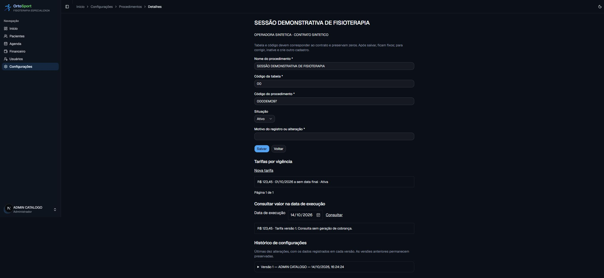
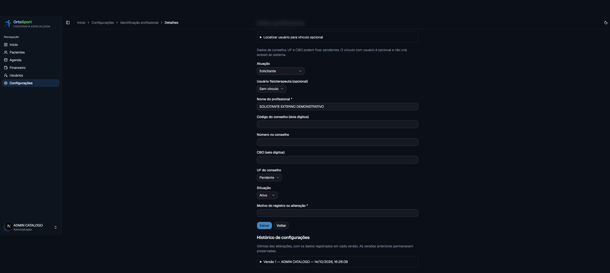

# ADM-01 — catálogo, tarifas e identificação profissional (#97)

Entrega local de 14/10/2026. Operadora piloto, manual/versão aceita e volume continuam
pendentes na #96. Esta evidência não comprova CI remota, integração, deploy ou homologação.

## Resultado e acesso

ADMIN abre Configurações → Operadoras e contratos → contrato → Catálogo de procedimentos
e tarifas. Procedimento pertence ao contrato; tabela e código são textos imutáveis,
preservando zeros. Busca por nome/código, paginação, edição do nome e inativação.
Tarifa usa centavos, datas civis inclusivas e fim opcional; GiST impede sobreposição
ativa no banco. Consulta por data retorna valor ou pendência explícita.

Configurações → Identificação profissional permite solicitante, executante ou ambos;
conta de fisioterapeuta ativo é opcional. Conselho, número, UF e CBO ficam pendentes
quando desconhecidos. Não há conversão automática de CREFITO ou de convênio do paciente.
O cadastro não concede acesso ao sistema.

Escritas exigem autorização no servidor, autoria da sessão, motivo, versão e chave de envio.
Cadastro e histórico são atômicos e as versões anteriores permanecem preservadas.
Manutenção preserva as seis tabelas administrativas e as FKs impedem excluir usuários vinculados.

## Evidências do fluxo

- Administrador autenticado criou procedimento 000DEMO97, tabela 00, inteiramente fictícios.
- Criou tarifa R$ 123,45 com início em 01/10/2026 e fim aberto; consulta em 14/10/2026
  retornou exatamente esse valor e versão, sem gerar cobrança.
- Segunda tarifa no mesmo período foi recusada; formulário conservou valor, data e motivo.
  A verificação identificou perda da data em uma sequência de entrada nativa; corrigida
  com sincronização no evento de entrada e coberta por regressão.
- Solicitante externo foi salvo sem usuário, conselho, UF ou CBO; busca de fisioterapeuta
  ativo funciona sem expor e-mail/credenciais no seletor.
- Recepção recebeu Acesso negado ao abrir diretamente o detalhe do procedimento.
  Fisioterapeuta recebeu Acesso negado ao abrir diretamente profissionais.
- Console do navegador sem erros/avisos nos fluxos verificados. Servidor confirmou
  actions e leituras; redirecionou perfis sem permissão para /acesso-negado.

## Banco e compatibilidade

Migração aditiva 20261014170000_administrativo_operadoras consolidada antes de publicação:
as duas etapas locais não tinham sido aplicadas em ambiente compartilhado.
Ela cria as seis tabelas, FKs Restrict, checks, índices, btree_gist, exclusão por período
e triggers de identidade/versão/histórico. Passa pelo gate aditivo sem relaxar o pipeline.
29 migrações aplicadas com sucesso em base PostgreSQL 18 descartável vazia.
Teste adicional aplica a mudança sobre dados legados: usuários, paciente com operadora
em texto livre, clínica e financeiro permanecem idênticos; nenhum vínculo é inferido.

O snapshot de tarifa guarda valor e versões de procedimento/tarifa, além de código,
tabela e descrição. A cópia capturada e o histórico anterior não mudam com alterações.
ADM-03/ADM-05 ainda precisam persistir esses dados nos itens conferidos/fechados e testar
sua imutabilidade. O aceite relativo a itens finais depende dessas entregas consumidoras.

## Verificação técnica

Build de produção, TypeScript e lint aprovados. Regressão final: 99 suítes/1.190 testes
unitários, 34 suítes/206 testes PostgreSQL e 10 testes de pipeline, todos aprovados.
Testes unitários, PostgreSQL e pipeline
cobrem códigos, centavos, datas, intervalos, autorização, concorrência, replay, FKs,
isolamento por contrato, inativação e preservação na manutenção. Resultados finais
registrados no comentário da issue.

Todos os dados de teste são sintéticos e os bancos são descartáveis em localhost.
Nenhum identificador do XML anexado foi usado. Fonte de implementação da exclusão:
[documentação PostgreSQL de intervalos](https://www.postgresql.org/docs/18/rangetypes.html#RANGETYPES-CONSTRAINT).

## Pendências preservadas

- #96: operadora piloto/manual/canal/versão aceita e dimensionamento por volume.
- Dados reais e homologação: campos ficam parametrizáveis; formato válido não significa
  perfil aceito pela operadora.
- Integração/CI remota e publicação: código validado localmente; sem migração produtiva.
- Produção, autorizações, guias, lotes, XML e relatórios administrativos pertencem às
  próximas issues e não são gerados por esta entrega.
