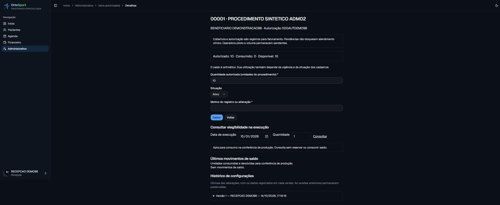
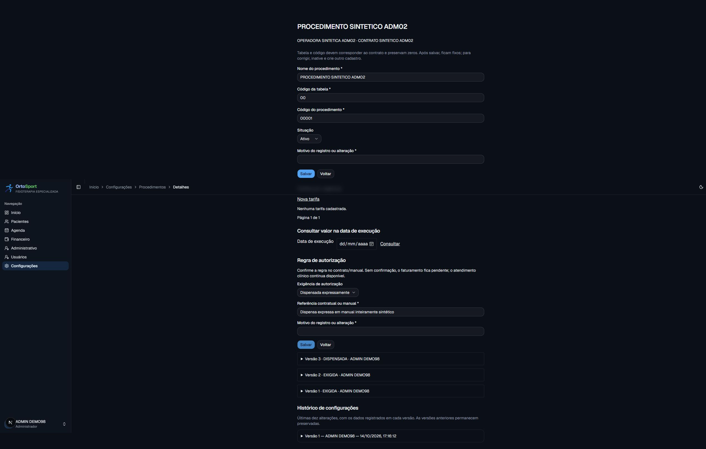

# ADM-02 — cobertura histórica e autorizações (#98)

Implementação e validação local em 14/10/2026, a pedido de Bruno para executar a próxima
issue após a #97. Operadora piloto/manual/versão e volume permanecem pendentes na #96.
Integração no repositório, CI remota e publicação são etapas distintas e não foram realizadas.

## Entrega

Menu Administrativo para ADMIN, Recepção e Fisioterapeuta. Busca de paciente sem acentos,
paginação e contexto explícito de paciente/contrato. Coberturas guardam beneficiário,
carteirinha textual, plano e vigência inclusiva, sem converter dados legados do paciente.
Autorizações recebidas guardam número, senha opcional, emissão, período e itens por
procedimento do mesmo contrato. Correções/cancelamentos têm motivo, autoria e versões.

Saldo por item: autorizado, consumido e disponível. Elegibilidade usa a execução, não
a data de lançamento ou a data atual. Uma autorização hoje vencida pode ter sido válida
na execução; as duas extremidades são inclusivas. Ausência, inativação, fora da vigência,
quantidade insuficiente e regra desconhecida são pendências explícitas.
Atendimento clínico não foi condicionado a cobertura/autorização.

ADMIN configura exigência, dispensa expressa ou pendência por procedimento/contrato,
sempre com referência e motivo; cada versão permanece preservada.
Nenhuma regra ou aprovação de operadora é presumida pelo cadastro.

## Consumo, consistência e próximos consumidores

O livro de consumo/devolução é imutável, com snapshot gerado pelo banco. Consumo positivo
e devolução negativa integral vinculada ao original; não há devolução automática em
cancelamento nem saldo proveniente do plano terapêutico. A devolução é única e motivada.
Consumo vigente bloqueia correção/inativação da cobertura e correção/cancelamento da
autorização. Quantidade do item não pode ficar abaixo do consumido nem o item ser inativado
com saldo consumido. FK composta impede misturar cobertura, autorização e procedimento
de contratos diferentes.

As primitivas internas de consumo/devolução operam na transação do consumidor. Elas
serão integradas à conferência da produção na #99; não há botão/action pública para
lançar consumo manual. Trava comum, FOR UPDATE na autorização, verificação de estados
e vigência, chave de origem e replay evitam excesso e duplicação. SQL direto também
respeita saldo, vínculos e imutabilidade. Falha posterior na transação desfaz o consumo.
Volume e capacidade final não foram medidos nem aprovados por esses testes.

Snapshots de carteira, beneficiário, autorização, procedimento e versões permanecem
nos movimentos antigos depois de correções permitidas. Guias/produção final ainda não
existem: ADM-03/ADM-05 deverão persistir a cópia e testar seus estados de fechamento,
impedindo devoluções de produção fechada fora da política aprovada.

## Verificação do fluxo autenticado

Recepção criou cobertura fictícia com carteira 000DEMO98, autorização 000AUTDEMO98,
emissão em fevereiro e validade de janeiro, e item com dez unidades. Consulta da execução
em 15/01/2026 retornou apta; onze unidades retornaram saldo insuficiente; 01/02/2026
retornou fora da vigência. As consultas mantiveram consumido em zero.

Recepção recebeu Acesso negado ao acessar diretamente a configuração do procedimento.
ADMIN registrou dispensa expressa e a consulta da cobertura refletiu a nova regra.
Fisioterapeuta abriu diretamente o item administrativo com o mesmo alcance aprovado.
As projeções consultadas não carregam evolução, diagnóstico ou prontuário.

Correções encontradas na verificação:

- Consultas com ramos de include no Prisma geravam aviso de consultas simultâneas no
  cliente pg transacional. Contexto passou a ser lido sequencialmente; servidor reiniciado
  e fluxo completo repetido sem novo aviso.
- Formulários de procedimento e regra tinham ids de motivo repetidos. Cada novo formulário
  passou a ter ids próprios. Entrada nativa de data/seleção conserva os valores ao editar
  outro campo, com regressões específicas.

## Banco, manutenção e recuperação

Migração aditiva 20261014190000_administrativo_coberturas, aplicada somente no PostgreSQL
18 descartável. As 30 migrações funcionaram em base vazia; teste adicional aplica a #98
sobre dados existentes e confirma paciente, financeiro e catálogo anterior intactos,
sem criar vínculos automaticamente.

BeneficiaryCoverage, BenefitAuthorization, AuthorizationItem, AuthorizationUse e
BeneficiaryChange dependem do paciente e entram juntos na reinicialização manual.
ProcedureAuthorizationRule é configuração histórica preservada. Novas FKs de autoria
entram na proteção de exclusão de usuário. Recuperação inclui as seis novas tabelas,
índices, funções, triggers e autores; cadastro e snapshot exigem a mesma transação.
Não houve ensaio de restauração em ambiente publicado.

## Validação final

- 104 suítes e 1.216 testes unitários aprovados.
- 36 suítes e 217 testes PostgreSQL aprovados, incluindo migração, concorrência,
  cancelamento versus consumo, replay, snapshots, FKs e manutenção.
- Build de produção, TypeScript e lint aprovados; gate aditivo e pipeline aprovados.
- Somente dados sintéticos em localhost; nenhum dado do XML anexado foi usado.

Issue mantida aberta para integração/revisão e rastreabilidade dos consumidores futuros.
Sem deploy, migração produtiva, envio, geração XML ou cobrança automática.
