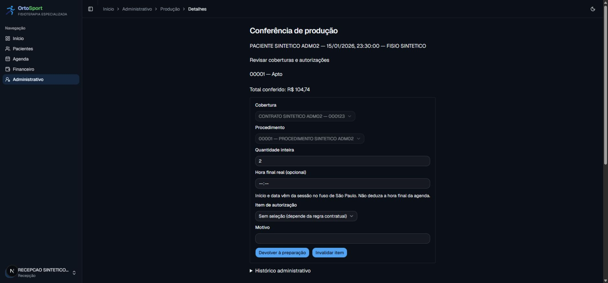

# ADM-03 — produção explícita vinculada à sessão (#99)

Implementação e validação local em 15/10/2026. Contratos da #96 e primitivas de catálogo,
elegibilidade e consumo das #97/#98 reaproveitados. Ainda não integrada/publicada.

## Resultado

Administrativo → Produção apresenta sessões com projeção mínima e paginação (20).
A fila de pendências inclui PENDENTE e ajuste após fechamento. Detalhe permite preparar,
conferir, devolver e invalidar itens por procedimento, com quantidade inteira, cobertura,
autorização, motivo e hora final real opcional. Data/hora inicial são da sessão em
America/Sao_Paulo. Vários procedimentos por sessão; um item ativo por sessão/procedimento,
com quantidade agregada. Não há cobrança, recebimento ou produção automática por presença.

Conferência resolve tarifa vigente e elegibilidade na mesma transação do consumo, total
bigint e snapshot. Duplicidade, versões concorrentes, reenvio e excedente de autorização
são protegidos. Produção devolvida/invalidada libera o consumo integral com histórico.
Regra desconhecida, falta de autorização/tarifa e saldo insuficiente mantêm pendência.

Correção/invalidação clínica revisa itens abertos atomicamente, devolvendo consumo e
exigindo conferência novamente. Item fechado mantém snapshot, valor e consumo e recebe
pendência de ajuste. FECHADO/ENVIADO são estados contratuais sem ação pública de fechamento
nesta issue; o teste prepara um fechamento sintético para exercitar a preservação.
SQL direto não pode corrigir sessão com produção sem versão e autoria no histórico.

revalidateProductionTx trava paciente → configuração → sessão/item e verifica novamente
a elegibilidade, incluindo o crédito do próprio consumo para não descontar saldo duas vezes.
Futuras guias/lotes devem selecionar e fechar na mesma transação, ordenando as travas.

## Verificação

- Prisma Client e tipos gerados; TypeScript e ESLint aprovados.
- 107 suítes / 1.222 testes unitários aprovados, incluindo negação antes de ler/gravar,
  projeção sem clínico e clique real de submissão do formulário.
- 37 suítes / 226 testes PostgreSQL aprovados na regressão completa; após refinamentos,
  produção/manutenção passaram em 18 testes e os nove testes finais de produção passaram
  novamente sobre a migração final em outra base vazia.
- Corridas reais: último saldo, dupla conferência, invalidação versus conferência e edição
  de tarifa versus conferência. Reenvio, devolução isolada recusada, snapshots, múltiplos
  procedimentos, fuso 23:30 São Paulo e sessão sem agenda também cobertos.
- 32 migrações aplicadas em PostgreSQL 18 descartável local; migração nova aditiva passa
  pelo gate existente. ProductionItem/ProductionChange entram em manutenção e recuperação;
  autoria entra na proteção de exclusão de usuário. Reset testado com ambas preenchidas.
- Build webpack de produção aprovado. Turbopack local apresentou a falha de criação de
  subprocesso CSS já observada no Windows; não foi alterado o bundler padrão do projeto.
- Dez testes de pipeline aprovados. Nenhuma execução de migração/deploy em ambiente remoto.

## Fluxo autenticado sintético

Recepção abriu a fila, ajustou uma pendência de sete para duas unidades, selecionou
000AUTH01 e conferiu com motivo. Item ficou APTO, total R$104,74 (2 × R$52,37).
Acesso direto às sessões clínicas retornou Acesso negado. Console sem erros/avisos.
A verificação detectou e corrigiu a falta de type=submit no botão; há regressão do clique.

## Limites e integração seguinte

Nenhuma guia/lote/XML criado. Hora final não é inferida. Perfil real de operadora e
homologação externa seguem em #103/#106. A seleção do detalhe limita cada conjunto a
100 opções com aviso explícito; listagem de sessões e fila são paginadas. Não se declara
benchmark de capacidade. As próximas issues devem respeitar os limites configurados
no contrato e a ordem de travas documentada no módulo.

A issue permanece para integração/revisão; esta evidência comprova implementação local,
separada de merge, publicação e homologação externa.
